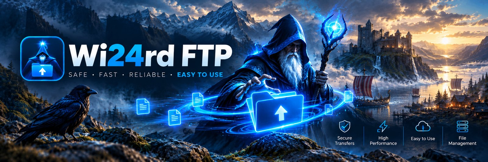
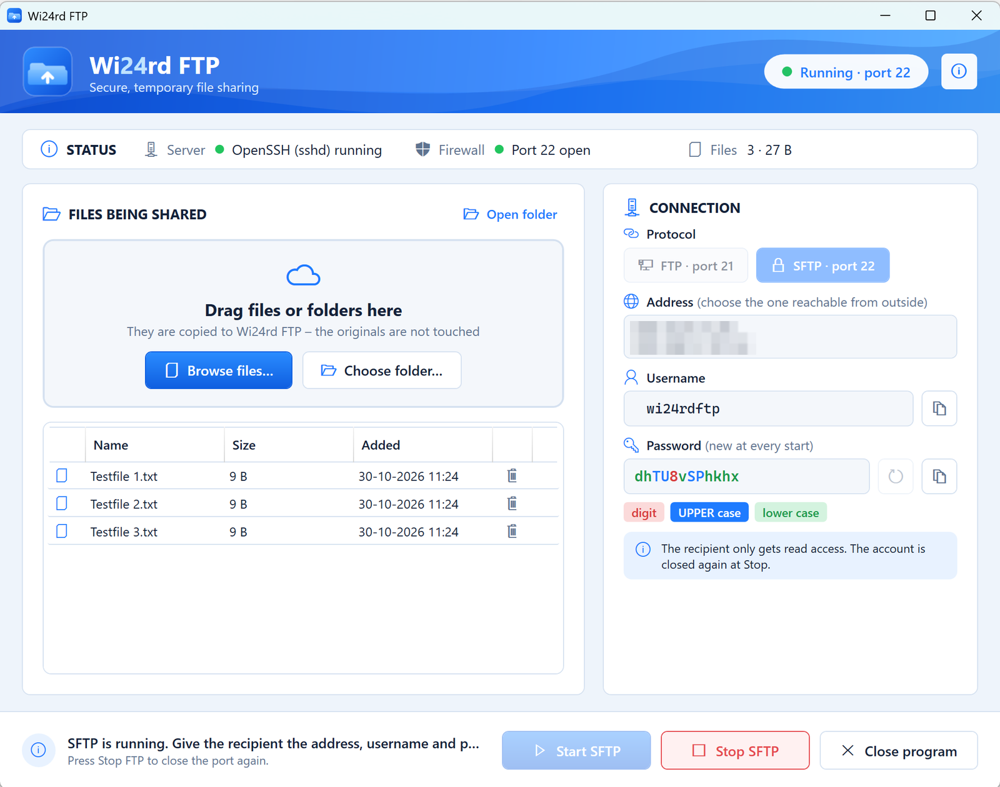

# Wi24rd FTP

**English** · [Dansk](README.da.md)

  
   
  Windows 10/11 · 64-bit · no .NET installation required · <a href="https://github.com/wi24rd-com/Wi24rd-FTP/releases">all versions</a>

Dead-simple, temporary file sharing on top of Windows 11's built-in **IIS FTP server** (ftpsvc) and **OpenSSH** (sshd).
Drag files in → Start → hand the recipient address + username + one-time password → Stop. Done.

> The installer is not code-signed yet, so SmartScreen may show "Windows protected your PC" the first time. Click *More info → Run anyway*, or verify the SHA256 against `SHA256SUMS.txt` on the release page.

The UI follows the Windows display language: Danish on Danish Windows, English otherwise.

**Free, and it stays that way**

- ✅ Free and open source (MIT) – no paid tier, no trial period
- ✅ No ads, no account, no registration
- ✅ No tracking or telemetry – the only connection the program makes itself is one anonymous request to GitHub at startup to check for a newer version
- ✅ Everything runs locally on your own PC – your files never pass through a third party

## How it works

| Button | What happens |
|---|---|
| **Start FTP / SFTP** | New one-time password for the `wi24rdftp` account · account enabled · ftpsvc (or sshd) started · firewall rule for port 21 (+ passive 50000-50100) or port 22 enabled · address and password shown in the GUI |
| **Stop FTP / SFTP** | Firewall rules disabled · service stopped · account disabled and given a new, unknown password · you are asked: *delete the files or keep them?* |
| **Close program** | Runs the Stop routine (if anything is running) → asks about the files → closes |

* Files are copied to `C:\Wi24rdFTP\Share` – the originals are never touched.
* The recipient has **read-only access** (IIS authorization = Read, plus an NTFS deny on write/delete for `wi24rdftp`).
* Everything that needs admin rights (services, firewall, account, IIS features) lives in `Scripts\Wi24rdFtp.ps1`, which the GUI runs elevated (UAC prompt at Start/Stop).
  The GUI itself runs **without** admin rights – on purpose: Windows blocks drag-and-drop from Explorer into elevated windows.
* First run: if ftpsvc is missing, the GUI shows a yellow banner with **Install now** (the installer does the same automatically).

## Install

Run `dist\Wi24rdFTP-Setup-1.0.0.exe`. The installer:

1. Puts the program in `C:\Program Files\Wi24rd FTP`
2. Runs `Wi24rdFtp.ps1 -Action Install`, which enables the Windows features `IIS-WebServerRole`, `IIS-FTPServer`, `IIS-FTPSvc`, `IIS-ManagementScriptingTools`, creates the `Wi24rdFTP` FTP site, the (disabled) firewall rules, the folders and the (disabled) account.

Uninstalling stops everything and removes the site, rules, account and sshd configuration. `C:\Wi24rdFTP` is kept.

## Where things are

* Shared files: `C:\Wi24rdFTP\Share` (the **Open folder** link in the app)
* Log, if something fails: `%ProgramData%\Wi24rdFTP\log\`

## Security notes

* **FTP is unencrypted** – password and files travel in clear text. Use **SFTP** whenever the recipient can (most clients: FileZilla, WinSCP, `sftp`). SFTP mode installs OpenSSH Server (a Windows capability; needs internet the first time).
* The password only lives from Start to Stop. The account is disabled and hidden from the logon screen while the server is not running.
* Access from the outside still requires a port forward on your router/firewall to the machine's IP – the program cannot do that for you.
* The app checks GitHub Releases at startup (one anonymous call, no telemetry) and shows a banner when a newer version exists.
* The passive FTP port range is 50000-50100 (set in IIS *FTP Firewall Support*). It may need to be opened on the router/firewall as well.

## Developer notes

Project layout, build instructions and the release process are in [DEVELOPMENT.md](DEVELOPMENT.md).

## License

[MIT](LICENSE) · © 2026 Wi24rd
